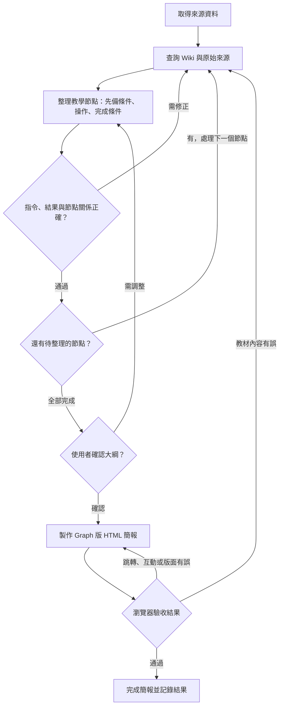

# Git 教學 LLM Wiki

這是一個給 Git 零基礎讀者的繁體中文知識庫。跟著 Windows PowerShell 範例練習工作目錄、暫存、提交、分支、合併衝突與遠端操作，最後在自己的 GitHub 練習儲存庫開出第一個 Pull Request。

## 開始學習

- [Wiki 學習路徑](wiki/index.md) · 依序閱讀 Git 基礎教材與實作。
- [GitHub Pull Request 實作](wiki/exercises/first-pull-request.md) · 建立分支、提交變更、推送並開啟 PR。
- [Graph 版 HTML 簡報](slides/index.html) · 14 張投影片，提供可點選的課程地圖、可切換的提交圖與可複製的 PowerShell 指令。複製或下載整個儲存庫並解壓縮後，用瀏覽器開啟 `slides/index.html` 即可離線閱讀。
- [來源索引](wiki/sources/index.md) · 列出原始 PDF 與教材引用的頁次。

## 專案結構與維護

專案參考 Karpathy 的 LLM Wiki 作法。`raw/papers/` 保存原始資料，`wiki/` 存放整理後的教材，`slides/` 與 `assets/` 存放簡報及共用貼圖。[AGENTS.md](AGENTS.md)記錄代理匯入來源、查詢與檢查內容的方式，[維護紀錄](wiki/log.md)保存更新與驗證結果。

## Loop / Graph 製作流程

- **Loop** · 同一個 Codex 代理逐一查詢、整理、檢查教學節點；發現問題時修正該節點，並重查相連的前置步驟或完成條件。
- **Graph** · 大綱由使用者確認，驗收結果決定下一步。Git 指令與提交圖的分支指向先用本機 Git 核對，再用瀏覽器檢查循序翻頁、地圖跳轉和圖表切換。出錯時回到對應步驟，重做受影響的部分。
